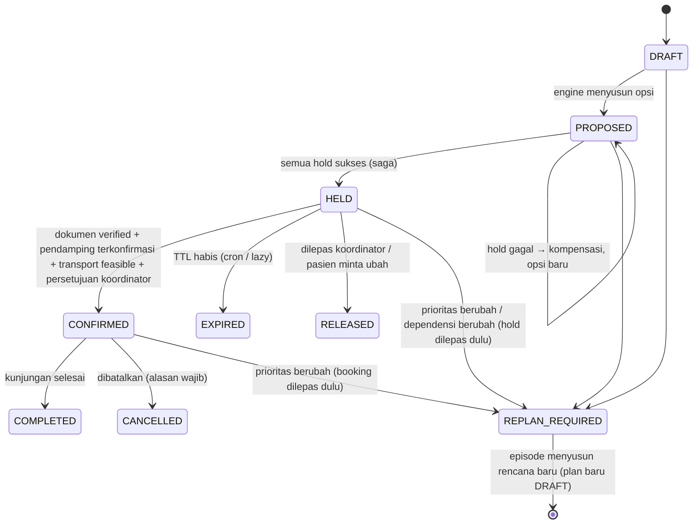

# PLAN.md — RujukSekali MVP + Company Profile

> Status: **Disetujui ("setuju semua") pada 2026-10-20; semua fase selesai.** Kondisi kode terkini dijelaskan di `docs/ARSITEKTUR.md`; penyimpangan dari rencana dicatat di §14.
> Nama produk "RujukSekali" bersifat sementara; semua kemunculan nama akan bersumber dari `src/config/brand.config.ts`.
> Penanda **[ASUMSI]** = keputusan default yang bisa diubah. **[PERLU DIVERIFIKASI]** = aturan domain/regulasi yang tidak boleh dianggap benar sebelum ditinjau.

---

## 0. Hasil pemeriksaan repo

- Direktori `RUJUK-SEKALI/` **kosong** dan **belum** berupa repo git.
- Toolchain lokal: Node v25.2.1, npm 11.6.2, Docker 29.8.1, Docker Compose v5.5.1.
- Rencana: `git init` di awal Fase 1 (PLAN.md di-commit sebagai commit pertama). Proyek menargetkan **Node 22 LTS** (`.nvmrc` + `engines: ">=22"`); Node 25 tetap bisa dipakai lokal.

---

## 1. Pertanyaan klarifikasi (maks. 8), masing-masing dengan asumsi default

Balas "setuju semua" bila default diterima, atau sebutkan nomor yang ingin diubah.

| #   | Pertanyaan                                                                                                                                                                                                  | Asumsi default bila tidak dijawab                                                                                                                                                                                                                                                                                                                                                                                                                                                                                  |
| --- | ----------------------------------------------------------------------------------------------------------------------------------------------------------------------------------------------------------- | ------------------------------------------------------------------------------------------------------------------------------------------------------------------------------------------------------------------------------------------------------------------------------------------------------------------------------------------------------------------------------------------------------------------------------------------------------------------------------------------------------------------ |
| 1   | **Nama produk final, domain, dan bahan konten** (tagline, logo, kontak, alamat, nama/peran tim, entitas hukum)?                                                                                             | Tetap "RujukSekali" + tagline sementara. Domain: belum ada, jadi lokal `http://localhost:3000` (`/` = profile, `/app` = aplikasi). Semua bahan lain ditulis sebagai placeholder `[ISI: ...]` dan didaftar di `docs/COMPANY-PROFILE.md`. Logo: wordmark teks + ikon SVG sederhana buatan sendiri.                                                                                                                                                                                                                   |
| 2   | **Isolasi mode demo**: database demo terpisah yang di-reset berkala, atau sandbox per sesi pengunjung?                                                                                                      | **Database Postgres terpisah** (`rujuksekali_demo`, skema dan migrasi sama), di-reset dan di-seed ulang **setiap 1 jam** serta lewat perintah `npm run demo:reset`. Semua pengunjung demo berbagi sandbox yang sama; aksi tulis dibatasi rate limit. Supaya skenario 1 selalu bisa dicoba meski pengunjung lain sudah "menyetujui", seed membuat **beberapa salinan** episode skenario 1, dan tautan dari profile mengambil salinan yang masih segar. Sandbox per sesi tidak dibangun (biaya kompleksitas tinggi). |
| 3   | **ORM**: Drizzle atau Prisma?                                                                                                                                                                               | **Drizzle**. Lebih dekat ke SQL sehingga `SELECT ... FOR UPDATE`, update bersyarat, partial index, dan trigger append-only bisa ditulis apa adanya. Tidak ada engine biner. Migrasi SQL terversi via `drizzle-kit`.                                                                                                                                                                                                                                                                                                |
| 4   | **Akses pasien**: cukup tautan bertoken, atau perlu OTP tambahan?                                                                                                                                           | **Tautan bertoken saja** (sesuai spesifikasi). Token acak 32 byte, disimpan sebagai hash SHA-256, berlaku **72 jam** (konfigurabel), bisa dicabut. Saat dibuka, token **ditukar menjadi cookie sesi HttpOnly**, lalu pengguna di-redirect ke `/p` supaya token hilang dari address bar dan riwayat. Tanpa OTP.                                                                                                                                                                                                     |
| 5   | **Default hold**: tier TTL, rasio hold maksimum, batas perpanjangan?                                                                                                                                        | Tier `singkat` = 2 jam, `standar` = 24 jam, `panjang` = 48 jam. Default episode = `standar`. Rasio hold maks. **30%** per layanan per hari. Perpanjangan maks. **2 kali**, masing-masing ≤ durasi tier, wajib beralasan. TTL rencana = TTL terpendek di antara layanan dalam rencana. Semua nilai bisa diubah admin unit.                                                                                                                                                                                          |
| 6   | **Parameter biaya pasien** untuk skor dan estimasi?                                                                                                                                                         | Nilai sintetis yang ditandai sebagai estimasi: transportasi dari data jadwal statis per kabupaten (tarif per kursi), penginapan Rp250.000/malam, kehilangan penghasilan Rp150.000/hari kunjungan. **Kehilangan penghasilan ikut dihitung secara default**, bisa dimatikan per episode. Mata uang IDR bulat, disimpan sebagai integer.                                                                                                                                                                              |
| 7   | **Aturan layanan default** [PERLU DIVERIFIKASI]: lab puasa = mulai paling lambat 10:00 WIB; hasil lab siap 180 menit; jeda minimum lab→poli 0 menit sesudah hasil siap; masa berlaku surat rujukan 90 hari? | Dipakai sebagai default seed, semuanya konfigurabel dan dicatat sebagai asumsi di `docs/COMPLIANCE-NOTES.md`. Tidak ada yang di-hard-code di engine.                                                                                                                                                                                                                                                                                                                                                               |
| 8   | **Target deploy MVP**: hanya lokal (Docker), atau langsung ke hosting tertentu (Vercel/Railway/VPS)?                                                                                                        | **Lokal saja** untuk MVP. Konfigurasi dua domain (`PUBLIC_SITE_URL`, `APP_URL`, `COOKIE_DOMAIN`) sudah siap dan diuji lewat env, tetapi tidak di-deploy. Lighthouse diukur pada `next build && next start` lokal.                                                                                                                                                                                                                                                                                                  |

---

## 2. Arsitektur

### 2.1 Gambaran besar

Satu paket Next.js (App Router), TypeScript `strict`. Lapisan dipisah tegas; panah = "boleh mengimpor".

```
app (UI/route handlers) ──► server (use-cases, repo, adapters) ──► domain (state machine) ──► engine (murni)
                                     │                                     │
                                     └──► db (Drizzle schema)              └──► (tanpa I/O, tanpa Date.now)
sim/ (simulator) ──► engine + domain   (tanpa DB, tanpa Next)
```

- **`src/engine/`** murni dan deterministik. Tanpa I/O, tanpa `Date.now()`, tanpa impor Next/Drizzle. Semua waktu masuk sebagai input. Aturan impor dijaga ESLint `no-restricted-imports`.
- **`src/domain/`**: state machine TripPlan/Hold sebagai tabel transisi + fungsi `transition(state, event)` yang mengembalikan state baru atau error bertipe. Juga murni.
- **`src/server/`**: use-case (`createHold`, `confirmPlan`, `releaseHold`, `extendHold`, `expireDueHolds`, `markPriorityChanged`, `submitLead`), repository Drizzle, adapter, auth, rate limit, idempotensi, logger.
- **`src/app/`**: UI dan route handler tipis. Validasi zod di batas sistem, lalu panggil use-case.
- **`sim/`**: simulator discrete-event yang memakai engine dan domain yang sama, dengan "repo" in-memory.

### 2.2 Keputusan teknologi

| Area           | Pilihan                                                                                                       | Alasan singkat                                                                                                                                                                                                                  |
| -------------- | ------------------------------------------------------------------------------------------------------------- | ------------------------------------------------------------------------------------------------------------------------------------------------------------------------------------------------------------------------------- |
| Framework      | Next.js (stabil terbaru saat Fase 1), App Router                                                              | Sesuai default. Satu repo untuk profile + aplikasi + API.                                                                                                                                                                       |
| DB             | PostgreSQL 16 via Docker Compose                                                                              | Semantik lock/transaksi diuji di DB nyata.                                                                                                                                                                                      |
| ORM            | Drizzle + `drizzle-kit` (lihat Q3)                                                                            | SQL eksplisit untuk konkurensi.                                                                                                                                                                                                 |
| Validasi       | zod                                                                                                           | Satu skema untuk form, API, dan env.                                                                                                                                                                                            |
| UI             | Tailwind CSS v4 + design tokens CSS variables                                                                 | Token dipakai bersama oleh profile dan aplikasi.                                                                                                                                                                                |
| Font           | Plus Jakarta Sans via `next/font` (self-host saat build)                                                      | Tanpa request pihak ketiga saat runtime. Huruf karya desainer Indonesia, cocok dengan identitas.                                                                                                                                |
| Ikon/ilustrasi | SVG buatan sendiri (inline komponen)                                                                          | Tanpa foto stok, tanpa library ikon besar.                                                                                                                                                                                      |
| Grafik         | Komponen SVG sederhana buatan sendiri                                                                         | Cukup untuk garis/batang TTL. Tanpa library chart.                                                                                                                                                                              |
| Test           | Vitest (unit, property via `fast-check`, integrasi DB), Playwright (E2E), `@axe-core/playwright`, `@lhci/cli` | Sesuai default.                                                                                                                                                                                                                 |
| Lint/format    | ESLint (`eslint-config-next` + jsx-a11y) + Prettier                                                           | jsx-a11y penting untuk target WCAG.                                                                                                                                                                                             |
| Auth staf      | Sesi berbasis cookie HttpOnly + tabel `session`; password di-hash dengan `scrypt` dari `node:crypto`          | Kebutuhan MVP sempit (3 peran, login email+password). Auth.js tidak diperlukan.                                                                                                                                                 |
| Waktu          | UTC di DB (`timestamptz`); tampilan WIB                                                                       | WIB = UTC+7 tetap (tanpa DST), jadi helper konversi kecil cukup tanpa library zona waktu. Clock di-inject (`Clock { now(): Date }`).                                                                                            |
| RNG simulator  | PRNG seeded kecil (mulberry32) di `sim/rng.ts`                                                                | Beberapa baris. Tidak perlu dependensi.                                                                                                                                                                                         |
| Rate limit     | Tabel Postgres fixed-window                                                                                   | Konsisten antar-instance dan bisa diuji. Cukup untuk MVP.                                                                                                                                                                       |
| Job expiry     | Route `POST /api/cron/expire` (dilindungi secret) + _lazy expiry_ saat baca; antarmuka `JobScheduler`         | Bisa diganti queue nyata nanti tanpa mengubah use-case.                                                                                                                                                                         |
| Analitik       | **Tidak ada** di MVP                                                                                          | Tanpa tracker = tanpa cookie banner dan tanpa risiko privasi. Bila nanti perlu: analitik self-hosted tanpa cookie (dicatat sebagai opsi, bukan dibangun).                                                                       |
| Solver         | Backtracking terbatas buatan sendiri, **tanpa CP-SAT**                                                        | Ruang masalah MVP kecil (2 layanan × ≤ 30 hari × puluhan slot). CP-SAT menambah runtime Python/WASM, membuat hasil sulit dijelaskan, dan menyulitkan property test. Ditinjau ulang bila layanan > 5 atau waktu engine > 200 ms. |

### 2.3 Adapter (antarmuka + mock)

| Port                      | Mock MVP                                                   | Perilaku uji                                                       |
| ------------------------- | ---------------------------------------------------------- | ------------------------------------------------------------------ |
| `ScheduleAdapter` (SIMRS) | Mencerminkan tabel `slot` lokal; `reserve/release/commit`  | Fault injection: gagal pada slot ke-N, timeout, status tidak pasti |
| `DocumentVerifier`        | Unggah mock dan verifikasi manual oleh koordinator         | Status `missing → uploaded → verified / expired`                   |
| `Notifier`                | Tulis ke tabel `outbox` dan tampilkan di "kotak masuk dev" | Template tanpa detail klinis, diuji                                |
| `TransportProvider`       | Jadwal statis per kabupaten + tarif                        | Feasibility tiba/pulang                                            |

Kontrak adapter: setiap panggilan punya timeout. Hasil `uncertain` (timeout/5xx) **diperlakukan sebagai gagal**: lakukan kompensasi (release idempoten) dan **jangan konfirmasi** (gagal-aman).

---

## 3. Skema data (Postgres, Drizzle)

Semua `id` adalah `uuid` (kecuali `audit_log` = `bigserial`). Semua waktu `timestamptz` UTC. Uang dalam `integer` IDR.

**Referensi & kapasitas**

- `facility(id, name, code)`. Seed: "RS Contoh Nusantara" (ini data seed, bukan merek produk).
- `service_type(id, code {LAB_DARAH, POLI_PD}, name, duration_min, prep_rule jsonb {fasting, latest_start_local}, result_ready_min, hold_ttl_minutes jsonb {singkat, standar, panjang}, max_hold_ratio numeric, max_extensions int)`
- `unit(id, facility_id, service_type_id, name)`
- `slot(id, unit_id, service_type_id, starts_at, ends_at, local_date date, status enum(available|held|booked|blocked), hold_id null, booked_plan_id null)`
  - `UNIQUE(unit_id, starts_at)`
  - `CHECK ((status='held') = (hold_id IS NOT NULL))`, `CHECK ((status='booked') = (booked_plan_id IS NOT NULL))`
- `capacity_day(service_type_id, local_date, PRIMARY KEY)`: baris "mutex" per layanan per hari, dikunci `FOR UPDATE` saat cek rasio hold. Jumlah held dihitung langsung dari `slot`, bukan counter, supaya tidak bisa melenceng.
- `capacity_denial(id, service_type_id, local_date, at, reason, episode_id)`: dicatat setiap kali permintaan slot gagal saat ada slot yang sedang ditahan. Dipakai untuk metrik _displacement_.

**Pasien & episode**

- `patient(id, pseudonym, origin_regency, distance_km, travel_minutes, mobility_needs text[], national_id_hmac bytea null)`. NIK **tidak pernah disimpan**. Hanya HMAC-SHA256 dengan pepper dari env, untuk deduplikasi/lookup. Alasan: lookup tetap bisa, kebocoran DB tidak membuka NIK, dan pepper bisa dirotasi. (Data seed sintetis tetap melewati jalur ini.)
- `escort(id, patient_id, pseudonym, relation)`, `escort_availability(id, escort_id, local_date, from_local, to_local, status proposed|confirmed|cancelled)`
- `episode(id, patient_id, title, status, earliest_date, latest_date, priority enum(rutin|segera) — diisi manusia, urgent_flag bool, requires_escort bool, hold_tier, include_lost_income bool, created_by, version)`
- `episode_service(episode_id, service_type_id)`
- `dependency(id, episode_id, type enum(PRECEDENCE|DOCUMENT_READY|ESCORT_AVAILABLE|TRANSPORT_FEASIBLE), from_service_type_id null, to_service_type_id null, min_gap_min int null, params jsonb)`
- `document(id, episode_id, kind enum(surat_rujukan|hasil_lama), status enum(missing|uploaded|verified|expired), valid_until date null, verified_by null, verified_at null, file_ref null)`. Isi file mock tidak disimpan, hanya nama file sintetis.
- `transport_option(id, origin_regency, mode, depart_local, arrive_local, return_depart_local, return_arrive_local, fare_idr, days_of_week int[])`

**Rencana & hold**

- `trip_plan(id, episode_id, status, rank, score jsonb, explanation text, approved_by null, approved_at null, version int, created_at)`
  - partial unique index: maks. satu plan `HELD|CONFIRMED` per episode
- `plan_visit(id, trip_plan_id, slot_id, service_type_id, starts_at)`
- `hold(id, trip_plan_id UNIQUE, status enum(pending|active|released|expired|converted), tier, expires_at, reason, extensions_count, created_at)`: **satu hold per rencana**. Semua slot rencana menunjuk `hold_id` yang sama, sehingga TTL dan perpanjangan selalu seragam.
- `hold_extension(id, hold_id, by_user_id, reason, old_expires_at, new_expires_at, at)`

**Lintas-sistem**

- `audit_log(id bigserial, at, actor_type, actor_id, entity, entity_id, action, from_state, to_state, reason, correlation_id, data jsonb)`. **Append-only** dijaga trigger yang menolak `UPDATE/DELETE`, dan role aplikasi hanya diberi `INSERT/SELECT`. `data` melewati redaksi (tanpa PII/klinis).
- `idempotency_key(scope, key, request_hash, status_code, response jsonb, created_at, PRIMARY KEY(scope, key))`. Key sama tetapi body berbeda menghasilkan 422.
- `outbox(id, channel, recipient_ref, template, payload jsonb, status, created_at)`. Payload hanya waktu, tempat, instruksi umum.
- `app_user(id, email, name, role enum(coordinator|unit_admin|system_admin), password_hash)`, `session(id_hash, user_id, expires_at, created_at)`
- `patient_access_token(token_hash, episode_id, expires_at, revoked_at null)`
- `rate_limit(bucket, window_start, count, PRIMARY KEY(bucket, window_start))`

**Marketing (dipisah di skema Postgres `marketing`)**

- `marketing.lead(id, name, organization, role, contact_channel enum(email|whatsapp), contact_value, need text, consent_at, consent_text_version, status enum(baru|dihubungi|selesai|ditolak), created_at)`. Tidak ada FK ke data pasien. Kolom `need` ditolak bila mengandung pola 16 digit (heuristik NIK) atau kata kunci klinis tertentu, dengan pesan yang ramah.

Database demo (`rujuksekali_demo`) memakai migrasi yang sama. Koneksi dipilih per zona (`getDb('app' | 'demo')`). Kode demo **tidak pernah** menerima koneksi produksi (dijaga tipe + test).

---

## 4. Mesin penyusun perjalanan (`src/engine/`)

**Tanda tangan**

```ts
planTrips(input: PlanningInput, params: CostParams): PlanningResult
// PlanningResult = { plans: CandidatePlan[] /* ≤3, terurut */, rejections: Rejection[] }
```

`PlanningInput` berisi episode (jendela, prioritas, butuh pendamping), daftar layanan + aturan, snapshot slot `available`, dependensi, jendela pendamping, opsi transportasi, status dokumen, dan `now`.

**Algoritma (backtracking terbatas)**

1. Urutkan layanan secara topologis menurut `PRECEDENCE` (siklus → error input).
2. Pra-saring slot per layanan: jendela klinis, aturan persiapan (puasa → `start ≤ latest_start_local`), hari dengan transportasi feasible, dan (bila wajib) hari dengan pendamping tersedia. Setiap penyaringan **mencatat hitungan alasan** untuk pesan penolakan.
3. DFS menetapkan slot per layanan dengan urutan: tanggal ↑, jam mulai ↑, `slot.id` ↑ (tie-breaker eksplisit, jadi deterministik). Pruning: `PRECEDENCE` (`start_B ≥ end_A + result_ready + min_gap`) dan batas bawah leksikografis terhadap kandidat terburuk di top-K.
4. Untuk setiap penetapan multi-hari, buat **varian strategi celah hari**: `menginap` vs `pulang-pergi` per celah. Varian yang tidak feasible secara transportasi dibuang.
5. Skor leksikografis (tuple dibandingkan per elemen):
   `[hariKunjungan, biayaPasienIDR, keterlambatanHari, slotMenitDitahan, mulaiPertamaEpoch, idSlotGabungan]`
6. Ambil top-3 dengan **set hari yang berbeda**, atau varian strategi yang berbeda, agar opsi benar-benar berbeda.
7. Hasilkan penjelasan Bahasa Indonesia dari template berdasarkan fakta skor. Contoh: "Satu kali datang: ambil darah 07:30 (puasa), hasil siap 10:30, konsultasi 11:00. Perkiraan biaya Rp420.000."
8. Bila nol rencana: bangun `Rejection[]` spesifik dari hitungan penyaringan + kandidat terdekat yang melanggar satu constraint lunak. Contoh: "Tidak ada slot poli di hari yang sama setelah hasil lab siap. Opsi terdekat: 2 hari berurutan (+1 malam menginap, ±Rp250.000)."

**Batas**: maksimum node DFS (default 20.000). Bila tercapai, kembalikan hasil terbaik + flag `truncated` agar koordinator tahu.

**Pengujian**: unit (setiap constraint), property-based (`fast-check`: input acak valid → setiap rencana lolos validator constraint keras yang **ditulis terpisah** dari engine; plus determinisme: dua kali panggil menghasilkan output identik), dan skenario penerimaan 1, 3, 4.

---

## 5. State machine dan siklus hold (`src/domain/`, `src/server/holds/`)



`* → REPLAN_REQUIRED` hanya dari state aktif. `EXPIRED/RELEASED/CANCELLED/COMPLETED` bersifat terminal. Status episode diturunkan dari plan aktifnya + `REPLAN_REQUIRED` / `URGENT_MANUAL`.

**Membuat hold (saga all-or-nothing)**

1. Cek idempotency key (dalam transaksi yang sama).
2. **Transaksi lokal**: kunci baris `capacity_day` untuk tiap (layanan, tanggal) **dalam urutan terurut** (hindari deadlock), lalu cek rasio hold. Lalu `UPDATE slot SET status='held', hold_id=$h WHERE id = ANY($ids) AND status='available' RETURNING id`. Bila jumlah baris < jumlah slot: **rollback seluruhnya**, catat `capacity_denial`, dan susun ulang alternatif dengan snapshot segar. Bila lolos: `hold.status = pending`.
3. **Langkah eksternal**: `ScheduleAdapter.reserve` per slot. Bila ada yang gagal atau uncertain: `release` semua yang sudah di-reserve (idempoten), lalu transaksi lokal melepas slot (`hold → released`). Rencana tetap `PROPOSED` dengan penjelasan.
4. Semua sukses: `hold → active`, `plan → HELD`, `expires_at = now + TTL`, audit + outbox.

Satu-satunya pemenang pada perebutan slot terakhir dijamin oleh **update bersyarat di level baris Postgres** (row lock implisit), bukan cek-lalu-tulis di aplikasi.

**Konfirmasi**: transaksi, `SELECT trip_plan ... FOR UPDATE`, _lazy expiry_ (bila `expires_at ≤ clock.now()` maka expire dan tolak), cek semua syarat penting, lalu `slot → booked`, `hold → converted`, `plan → CONFIRMED`, audit, outbox. Ada syarat yang tidak pasti → tetap `HELD` (gagal-aman).

**Kedaluwarsa**: `expireDueHolds(now)` memakai `FOR UPDATE SKIP LOCKED` sehingga aman bila cron berjalan paralel. Slot kembali `available`, plan `EXPIRED`, audit, dan notifikasi ke koordinator. _Lazy_: snapshot slot dan halaman detail menjalankan expiry untuk entitas yang dibaca sebelum menampilkannya.

**Perpanjangan**: hanya `coordinator`, alasan wajib, `extensions_count < max_extensions`, dicatat di `hold_extension` + audit.

**Prioritas berubah**: satu transaksi melepas hold/booking terkait, `plan → REPLAN_REQUIRED`, mencatat audit, lalu engine menyusun ulang. Test memastikan tidak ada slot yang masih menunjuk hold non-aktif ("slot yatim" dicek dengan query invariant setelah setiap test integrasi).

**Flag mendesak**: episode `urgent_flag = true` → engine **tidak dijalankan**, episode masuk antrean manual dengan peringatan merah. Test memastikan tidak ada hold otomatis.

**Idempotensi**: semua endpoint mutasi (`hold`, `confirm`, `release`, `extend`, `cancel`) mewajibkan header `Idempotency-Key`. UI membuat key per aksi.

---

## 6. Routing dua zona (profile ⇄ aplikasi)

```
src/app/
  (marketing)/                      ← zona publik, statis (SSG), SiteHeader variant="marketing"
    page.tsx                        /
    cara-kerja/ untuk-rumah-sakit/ untuk-pasien/ keamanan-privasi/ tentang/
    hasil-simulasi/ minta-demo/ faq/ kebijakan-privasi/ syarat/
  (app)/                            ← zona kerja, SiteHeader variant="app"
    masuk/                          /masuk (login staf)
    app/                            /app/** (wajib login; dicek di middleware + server)
      page.tsx                      antrean tindakan
      episode/[id]/                 detail episode
      admin/unit/  admin/leads/     admin unit / system_admin
      metrik/  dev/inbox/
    demo/                           /demo/** (tanpa login, DB demo, banner "Mode demo — data sintetis")
      koordinator/  koordinator/episode/[id]/  p/[demoToken]/
    p/[token]/route.ts              tukar token → cookie, redirect ke /p
    p/                              halaman pasien (Referrer-Policy: no-referrer)
  api/ ...                          route handler (hold, confirm, lead, cron, session)
  not-found.tsx  sitemap.ts  robots.ts
```

- **Komponen bersama**: `SiteHeader` (`marketing | app | demo | patient`), `SiteFooter`, design tokens, `brand.config.ts`.
- **`src/config/links.ts`** satu-satunya sumber URL lintas zona: `links.site.home()`, `links.site.caraKerja('tahan')`, `links.app.dashboard()`, `links.demo.patient('skenario-1')`, dan seterusnya. Bila `PUBLIC_SITE_URL` dan `APP_URL` berbeda origin, helper mengembalikan URL absolut; bila sama, path relatif. Middleware me-redirect path ke domain yang benar.
- **`?from=`**: `safeReturnPath(from)` hanya menerima path yang **persis** ada di daftar rute marketing dari `links.ts` (opsional `#anchor` alfanumerik). Selain itu diganti beranda. Tidak pernah memakai URL absolut.
- **Status sesi di profile**: halaman profile tetap statis (demi Lighthouse). Saat login, server men-set cookie penanda non-rahasia `rs_signed_in=1` (domain = `COOKIE_DOMAIN`, tanpa data). Komponen klien kecil di header membaca cookie ini dan menampilkan "Buka Dashboard". Cookie sesi asli tetap HttpOnly. Logout menghapus keduanya.
- **Privasi pasien**: token hanya muncul sekali di `/p/[token]` lalu langsung ditukar. Halaman `/p` dikirim dengan `Referrer-Policy: no-referrer`. Tautan keluar memakai `rel="noopener noreferrer"` dan tidak membawa token. Profile hanya menautkan `links.demo.patient(...)`.

---

## 7. Metrik & simulator (ringkas; definisi persis di `docs/METRIK.md`)

- Metrik dihitung dari tabel operasional (dashboard + CSV) **dan** dari log event simulator, dengan fungsi perhitungan yang sama (`src/metrics/`).
- Simulator: antrean event berprioritas (kedatangan episode, unggah dokumen, keputusan pendamping, TTL habis, waktu layanan, no-show), RNG seeded, parameter sesuai bagian 9 prompt.
- Baseline "pesan satu per satu": tiap layanan dipesan independen pada slot paling awal yang tersedia, tanpa penyelarasan hari, tanpa hold.
- Keluaran: `sim/out/*.csv` + JSON yang dibaca halaman `/app/metrik` dan `/hasil-simulasi`. Angka di profile **dibaca dari file hasil simulasi yang di-commit**, bukan diketik manual.

---

## 8. Inventaris konten company profile

| Konten                                                 | Status                                     | Sumber                                        |
| ------------------------------------------------------ | ------------------------------------------ | --------------------------------------------- |
| Nama produk, tagline                                   | Sementara                                  | `brand.config.ts` (Q1)                        |
| Masalah, cara kerja 4 langkah, pembeda                 | **Bisa ditulis sekarang**                  | Dari prompt ini                               |
| Visual sebelum/sesudah di `/cara-kerja`                | **Bisa dibuat**                            | Output engine pada seed skenario 1 & 4        |
| Ringkasan hasil simulasi                               | Setelah Fase 6                             | `sim/out` (berlabel "simulasi data sintetis") |
| Manfaat RS, tahap pilot, kebutuhan dari RS             | **Bisa ditulis**                           | Prompt bagian 3, 4, 8A                        |
| FAQ pasien & umum                                      | **Bisa ditulis** (bahasa sederhana)        | Aturan produk                                 |
| Prinsip privasi                                        | **Bisa ditulis**, tanpa klaim kepatuhan    | Desain bagian 3 & 6                           |
| Kebijakan privasi, syarat                              | Draf, label "perlu ditinjau hukum"         | Placeholder hukum                             |
| Logo                                                   | Placeholder: wordmark + ikon SVG sederhana | `[ISI: logo final]`                           |
| Tim (nama, peran, foto)                                | **Placeholder**                            | `[ISI: anggota tim]`                          |
| Kontak (email, WhatsApp, alamat)                       | **Placeholder**                            | `[ISI: kontak]`                               |
| Entitas hukum, alamat kantor                           | **Placeholder**                            | `[ISI: ...]`                                  |
| Testimoni, logo klien, mitra, penghargaan, sertifikasi | **Tidak dibuat**                           | Dilarang (8A.4)                               |
| Domain, URL OG image                                   | Placeholder lokal                          | Q1                                            |

Semua placeholder `[ISI: ...]` dikumpulkan otomatis. Ada test yang menghasilkan daftar placeholder dari `src/content/` dan memastikan daftarnya sama dengan `docs/COMPANY-PROFILE.md`.

---

## 9. Strategi pengujian & `npm run check`

- `npm run check` = `lint` → `typecheck` → `test` (unit + property + integrasi DB) → `e2e` (Playwright, mulai Fase 4). `npm run check:fast` tanpa E2E untuk iterasi.
- Integrasi DB memakai database `rujuksekali_test` di container yang sama. Migrasi dijalankan sekali, tabel di-truncate antar-test. Uji konkurensi memakai **pool koneksi terpisah** dan `Promise.all` ≥ 20 permintaan.
- Invariant global yang dicek setelah setiap test integrasi: tidak ada slot `held` dengan hold non-aktif; tidak ada slot `booked` ganda; tidak ada hold aktif yang kedaluwarsa setelah `expireDueHolds(now)`.
- Pemetaan skenario penerimaan → test: 1,3,4 (Fase 2, engine); 2,5–10 (Fase 3, integrasi DB); 11–13 (Fase 7, E2E). Alur UI 1 & 2 juga dibuat E2E di Fase 4–5.
- Pemeriksaan "tidak ada hard-code": test yang men-scan `src/` untuk literal nama produk di luar `brand.config.ts` dan `href` path internal di luar `links.ts`. Bukti ganti nama: test menjalankan build dengan `BRAND_NAME_OVERRIDE=NamaUji` lalu memastikan HTML tidak mengandung "RujukSekali".
- Link checker: crawl Playwright dari `/`, semua tautan internal harus 200.
- Lighthouse CI (`@lhci/cli`, preset mobile, ambang 0.9) dan axe pada `/`, `/cara-kerja`, `/untuk-pasien`, `/minta-demo`.

---

## 10. Privasi & keamanan (ringkas)

- Data sintetis saja. Generator seed memakai nama samaran berpola jelas (mis. "Pasien A-017"), bukan nama yang tampak nyata.
- Logger terstruktur (JSON) dengan **redaksi berbasis allowlist field**, ditambah `correlation_id` per request (header `x-correlation-id`).
- CSRF: aksi mutasi via route handler/server action dengan cek `Origin` + cookie `SameSite=Lax`. Header keamanan: CSP ketat, `X-Content-Type-Options`, `frame-ancestors 'none'`.
- RBAC dicek di use-case (bukan hanya di UI). Token pasien dibatasi rate limit per IP.
- Secret hanya lewat `.env` (diabaikan git). Disediakan `.env.example`.

---

## 11. Risiko utama & mitigasi (dirinci di `docs/RISIKO-DAN-VALIDASI.md`, Fase 8)

| Risiko                                   | Mitigasi di desain                                                                            | Bukti/pengujian                   |
| ---------------------------------------- | --------------------------------------------------------------------------------------------- | --------------------------------- |
| Slot tertahan terlalu lama               | TTL bertingkat, rasio hold maks., perpanjangan terbatas, `capacity_denial`                    | Skenario 8, 10; eksperimen TTL    |
| Prioritas klinis berubah                 | `REPLAN_REQUIRED`, pelepasan otomatis satu transaksi                                          | Skenario 5 + invariant slot yatim |
| Sistem fasilitas lain lambat/gagal       | Timeout adapter, kompensasi, `uncertain` = gagal, tidak konfirmasi                            | Skenario 7 + fault injection      |
| Dependensi berubah di tengah jalan       | Event `document.expired` / `escort.cancelled` memicu `REPLAN_REQUIRED` atau blokir konfirmasi | Test integrasi                    |
| Rencana optimal tapi tidak realistis     | Penjelasan, persetujuan koordinator wajib, 3 opsi, pasien bisa minta ubah                     | E2E Fase 4–5                      |
| **Teknis:** deadlock antar-hold          | Kunci `capacity_day` dalam urutan terurut                                                     | Uji beban paralel                 |
| **Teknis:** drift zona waktu             | Engine bekerja dalam menit-sejak-epoch UTC; tampilan WIB via satu helper                      | Unit test batas tengah malam WIB  |
| **Teknis:** demo menyentuh data produksi | Koneksi per zona bertipe berbeda, test                                                        | Skenario 12                       |
| **Teknis:** Lighthouse < 90              | Profile SSG, font self-host, tanpa JS berat, SVG inline                                       | LHCI di `check` (Fase 7)          |
| **Konten:** klaim berlebihan             | Aturan 8A.4, angka hanya dari `sim/out`, review checklist                                     | Test placeholder + review manual  |

---

## 12. Urutan kerja & definisi selesai per fase

| Fase | Isi                                                                                                                                                                                                                                                                                                                            | Definisi selesai                                                                                                | Gerbang persetujuan?                       |
| ---- | ------------------------------------------------------------------------------------------------------------------------------------------------------------------------------------------------------------------------------------------------------------------------------------------------------------------------------ | --------------------------------------------------------------------------------------------------------------- | ------------------------------------------ |
| 0    | Orientasi, pertanyaan, PLAN.md                                                                                                                                                                                                                                                                                                 | PLAN.md disetujui                                                                                               | **Ya**                                     |
| 1    | `git init`, scaffold Next.js, Docker Compose (Postgres app/test/demo), skema + migrasi, seed sintetis deterministik (RS fiktif, 30 hari slot, ±40 pasien, fixture skenario 1–5), `brand.config.ts`, `links.ts`, design tokens, kerangka `(marketing)`/`(app)` + header/footer bersama, ESLint/Prettier/Vitest, `npm run check` | `docker compose up` + `npm run setup` jalan dari nol; `npm run check` hijau; halaman kerangka kedua zona tampil | **Ya** (skema & struktur final)            |
| 2    | Engine murni + validator constraint terpisah + property test + skenario 1, 3, 4                                                                                                                                                                                                                                                | Test hijau; determinisme terbukti; penjelasan & penolakan berbahasa Indonesia                                   | Tidak (kecuali muncul alasan pakai solver) |
| 3    | State machine, saga, konkurensi, idempotensi, expiry, audit, adapter mock; skenario 2, 5–10                                                                                                                                                                                                                                    | Uji paralel: tepat 1 pemenang; invariant slot yatim hijau                                                       | **Ya** (semantik hold)                     |
| 4    | Dashboard koordinator + E2E                                                                                                                                                                                                                                                                                                    | Alur: lihat antrean → pilih opsi → hold → verifikasi dokumen → konfirmasi, teruji E2E                           | Tidak                                      |
| 5    | Halaman pasien bertoken, unggah mock, konfirmasi pendamping, outbox, a11y                                                                                                                                                                                                                                                      | E2E pasien + axe tanpa pelanggaran kritis; token tidak bocor                                                    | Tidak                                      |
| 6    | Metrik, simulator, baseline, eksperimen TTL, `docs/METRIK.md`, `docs/EKSPERIMEN-TTL.md`                                                                                                                                                                                                                                        | Simulasi reproducible (seed sama → CSV identik)                                                                 | Tidak                                      |
| 7    | Company profile lengkap, demo sandbox, Lead + panel admin, `?from=`, E2E dua arah, link checker, axe, LHCI; skenario 11–13                                                                                                                                                                                                     | Semua halaman 8A.2; LHCI ≥ 0.9; `docs/COMPANY-PROFILE.md` lengkap                                               | **Ya** (konten/desain)                     |
| 8    | README + semua dokumen `docs/` + bukti ganti nama                                                                                                                                                                                                                                                                              | Checklist DoD bagian 16 prompt terpenuhi                                                                        | Penyerahan                                 |

Setiap fase diakhiri dengan `npm run check`, commit kecil, dan laporan ≤ 15 baris (format bagian 17).

---

## 13. Yang sengaja tidak dibangun

Integrasi nyata (BPJS, SATUSEHAT, SIMRS, pembayaran, WA/SMS, tiket), triase/prioritas otomatis, alur darurat, CMS/blog, sandbox demo per sesi, i18n multi-bahasa (kode tetap siap: semua teks UI di `src/content/` / kamus), analitik, deploy hosting.

---

## 14. Penyimpangan dari rencana (dicatat setelah implementasi)

- **Demo per pengunjung:** selain DB demo terpisah yang dibangun ulang (tiap 6 jam / ganti hari), `/demo/mulai` membuat
  salinan skenario baru per kunjungan sehingga demo selalu segar — menggantikan ide "beberapa salinan skenario di seed".
- **Satu hold per rencana** dengan status internal `pending` (saga); `pending` yang tertinggal dikompensasi otomatis.
- **TTL dibatasi kunjungan pertama:** penahanan tidak pernah berlaku melewati (kunjungan pertama − lead time).
  Ditemukan saat membangun simulator.
- **Middleware → `src/proxy.ts`** (Next.js 16 mengganti nama middleware menjadi proxy).
- **Aksi UI** memakai server action + idempotency key dari klien; route handler hanya untuk cron, CSV, dan tukar token.
- **Toaster** global untuk hasil aksi (hasil tetap terlihat walau kartu opsi diganti opsi baru).
- **Database E2E terpisah** (`rujuksekali_e2e`, `rujuksekali_e2e_demo`) agar E2E tidak menyentuh data dev.
